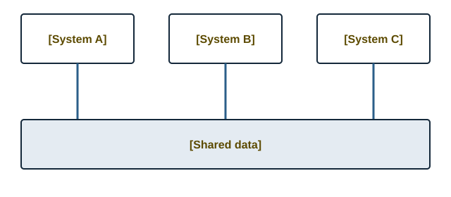

import { Steps } from "@astrojs/starlight/components";

## Why this matters

A small retailer may use one application for in-store sales, another for stock, a spreadsheet for supplier orders and separate software for accounting. When these tools do not exchange information reliably, staff must repeat work and the records can disagree.

Enterprise systems and integration help connect business functions so that information can be shared more consistently. For an SME, the goal is not necessarily to purchase a large enterprise system. It is to ensure that the tools used for essential business activities work together reliably and suit the organisation's needs.

:::tip[Key takeaway]
Integrated systems can reduce duplicate data entry and improve the consistency of business records, but successful integration still depends on accurate data, appropriate configuration and reliable processes.
:::

## Key concepts

### What is an enterprise system?

An enterprise system supports multiple business functions through connected processes and shared information. An Enterprise Resource Planning (ERP) system is one example. It can bring functions such as purchasing, inventory, sales and accounting together within one platform.

Davenport (1998) explains how enterprise systems connect business processes and information across an organisation. This can improve coordination, although implementation may require changes to existing workflows.

### What does system integration mean?

System integration allows separate applications to exchange information and coordinate their activities.

For example, a point-of-sale (POS) system can send sales information to inventory software. An integration with accounting software may then transfer appropriate financial information for recording and reconciliation.

Application Programming Interfaces (APIs) are one way applications exchange data. Other approaches may include built-in connectors, scheduled imports or file transfers. The appropriate method depends on the software and the business requirements.

_The diagram illustrates how connected systems can share business information. The exact flow depends on how each integration is configured._

## The core parts of a connected retail business

Four areas commonly need to exchange information.

### 1. Point of sale

The POS is where staff record in-store sales, process payments and issue receipts. It provides transaction information that can be used to update stock and support accounting.

### 2. Inventory management

Inventory software records quantities received, quantities sold and adjustments for returns or damaged goods. It can also support reorder thresholds and stock alerts.

### 3. Accounting and bookkeeping

Accounting software records financial transactions and supports tasks such as sales reconciliation, supplier balances, expense tracking and financial reporting. VAT-related transactions must be handled according to the business's circumstances and applicable requirements.

### 4. Online storefront

An e-commerce platform allows customers to browse products and place orders online. When it is connected to inventory management, changes in available stock can be reflected online, helping reduce the risk of selling unavailable products.

## How the systems communicate

Without integration, staff may need to enter the same information into several applications. This takes time and creates opportunities for mistakes.

A connected process can work as follows:

1. A cashier processes a sale through the POS.
2. The sale updates the relevant inventory record.
3. The available quantity is communicated to the online storefront, where the integration supports it.
4. Appropriate sales and payment information is transferred to accounting software.
5. The owner reviews the records and reconciles transactions against payment-provider reports and bank deposits.

Not every integration operates instantly. Some update continuously, while others synchronise on a schedule. The business should understand how quickly changes are reflected and how failed or duplicated transactions are handled.

## Example from our shop

:::note[Shop example]
A retailer sells shoes both in a physical shop and through an online store. The last pair of size 8 sneakers is sold at the counter on Saturday afternoon.

**Without integration:** The online catalogue still shows the sneakers as available. An online customer orders them that evening, and the owner must cancel the order and arrange a refund.

**With integration:** The in-store sale updates the central stock record, and the connected online storefront receives the updated availability. This reduces the chance of overselling, provided the synchronisation works correctly.

The POS can also send relevant transaction information to accounting software, reducing repeated entry. The owner still needs to reconcile sales, fees, refunds and bank deposits.
:::

## Integration challenges for retail SMEs

### Challenge 1: Unstable internet and power interruptions

Some modern retail systems rely on cloud services, so connectivity or power interruptions can prevent staff from accessing essential functions.

**Practical response:**

- Choose a POS that supports offline transactions if the business needs to continue selling during internet outages.
- Understand where offline transactions are stored and how they synchronise when connectivity returns.
- Check for failed or duplicated transactions after reconnection.
- Consider suitable backup power for essential equipment.

Offline capability varies by system and may not cover every function, such as online payment processing or access to cloud reports.

### Challenge 2: Inconsistent spreadsheet records

Existing records may contain duplicate products, missing identifiers, outdated prices and incorrect quantities. Importing these records without checking them can transfer the same problems into the new system.

**Practical response:**

- Remove duplicate entries and correct inconsistent product names.
- Standardise product identifiers, such as stock-keeping units (SKUs).
- Check supplier details, cost prices and retail prices.
- Conduct a physical stock count before importing quantities.
- Verify a sample of imported records and reconcile important totals.

Cleaning and validating records before migration helps establish a reliable starting point.

### Challenge 3: Staff hesitation and new working practices

Employees who are familiar with manual processes may worry that a new system will slow them down or make mistakes easier to notice. If they do not understand the system, they may continue using informal workarounds.

**Practical response:**

- Involve staff when identifying requirements.
- Provide practical training using typical transactions.
- Run a short pilot before switching fully.
- Explain the benefits and clarify responsibilities.
- Collect feedback and resolve problems early.

Implementation success depends on both technology and the way people use it. [See the discussion of enterprise system implementation in Markus and Tanis (2000).](/sources/#ref-17)

### Challenge 4: Card-payment reconciliation

Card and QR payment settlements may reach the business bank account later than the original sale. Settlement amounts may also differ from sales totals because of processing fees, refunds or other adjustments.

**Practical response:**

- Compare POS totals with payment-provider settlement reports.
- Match settlements against bank deposits.
- Account for fees, refunds and timing differences.
- Use supported accounting integrations or bank feeds where appropriate.
- Investigate unexplained discrepancies rather than assuming the amounts should always match on the same day.

A reliable reconciliation process is important even when the systems are integrated.

## Choosing an enterprise system

Retailers commonly consider two broad approaches.

### Option A: An all-in-one ERP suite

An ERP platform, such as Odoo or ERPNext, may provide modules for inventory, sales, purchasing and accounting within one environment.

**Advantages**

- Business functions may share data without requiring separate integrations.
- Staff may work within a more consistent set of processes.
- Centralised information can simplify reporting.

**Limitations**

- Configuration and implementation still require time.
- The range of features may be more complex than the business needs.
- Hosting, subscriptions, support and training can add to the total cost.

### Option B: Separate specialised applications

A retailer may use one application for POS, another for accounting and a separate e-commerce platform. The applications exchange information through supported integrations or APIs where available.

**Advantages**

- The business can select tools that suit individual requirements.
- Staff may find specialised applications easier to use for particular tasks.
- Individual applications may be replaced without replacing the entire system, provided compatible integrations remain available.

**Limitations**

- Connections must be configured and monitored.
- Separate subscriptions can increase the total cost.
- Synchronisation failures or inconsistent data definitions can create discrepancies.
- Staff may need to learn and switch between several applications.

### Comparing the trade-offs

| Factor                | All-in-one ERP                                                                         | Separate specialised applications                                              |
| --------------------- | -------------------------------------------------------------------------------------- | ------------------------------------------------------------------------------ |
| Setup and integration | Modules may already share information, but configuration is still required.            | Connections must be configured, tested and maintained.                         |
| Cost                  | Costs may be consolidated, but implementation, hosting and support can be significant. | Individual plans offer flexibility, but subscriptions can accumulate.          |
| Flexibility           | Depends on the platform's configuration and extension options.                         | Individual tools can be selected for specific needs, subject to compatibility. |
| Staff learning        | One platform may simplify workflows, but its breadth can increase complexity.          | Each application may be straightforward, but staff must learn multiple tools.  |
| Maintenance           | Fewer separate applications may simplify oversight, depending on the setup.            | More connections and providers may create additional support requirements.     |

There is no universally best option. The decision should reflect the retailer's size, budget, existing tools, staff capacity and future plans. [12] [13]

## A phased modernisation plan

<Steps>

1. **Weeks 1–2: Clean and standardise data.** Conduct a physical stock count, correct prices, consolidate supplier details and assign consistent identifiers to products. Back up the original records before making changes.

2. **Weeks 3–4: Establish the POS and inventory system.** Configure the till, import the cleaned catalogue, test barcode scanning and verify stock updates. Pilot the system with staff before fully switching.

3. **Weeks 5–6: Connect accounting.** Configure a supported integration where available. Compare recorded sales, payment-provider settlements, fees and bank deposits, investigating differences.

4. **Weeks 7–8: Connect the online storefront.** If the business sells online, configure inventory synchronisation. Test in-store sales, online orders, returns and stock adjustments to identify overselling or duplicate updates.

5. **Week 9 onwards: Review and improve.** Use reports to monitor sales, stock movement and operational performance. Introduce reorder alerts where supported, collect staff feedback and review whether the system is delivering the expected benefits.

</Steps>

The sequence can be adjusted to the business's needs. A retailer that does not sell online, for example, may not need the fourth stage.

## Sources for this topic

1. Davenport (1998), on enterprise systems and business processes.
2. Spathis and Constantinides (2004), on ERP systems and accounting processes.
3. Olson and Staley (2012), on ERP implementation in a small business.
4. Laudon and Laudon (2022), on management information systems.
5. Markus and Tanis (2000), on enterprise system implementation.

See the [full reference list](/sources/) for publication details.
